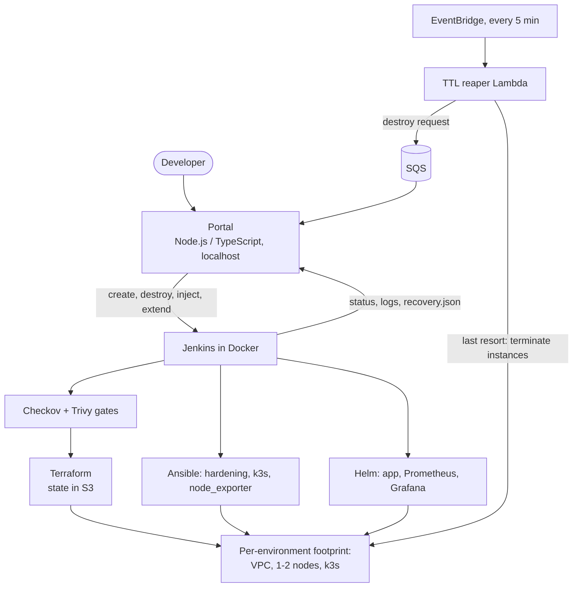

# Environment-as-a-Service (EaaS)

Self-service, time-limited, monitored environments on AWS, built entirely as code.

## The problem

Developers wait days for operations to hand them an environment. Builds are manual and inconsistent, nobody
tracks what an environment costs, and forgotten environments keep billing.

## What it does

A developer opens a portal, picks a name, a size and a time limit, and gets a complete environment in minutes:
its own VPC, a k3s cluster, a three-tier sample app and, for medium environments, Prometheus and Grafana, all
tagged with an owner and an expiry. When the time limit ends, the environment destroys itself, even if the
machine running the pipeline is switched off. The portal can also break an environment on purpose and measure
how long the platform takes to recover.


*Every environment shows its state, owner, time remaining, estimated cost and links.*

## Architecture



More detail: [system architecture](docs/architecture/system-architecture.md) and
[diagrams](docs/architecture/architecture-diagram.md).

## Quick start

Prerequisites: an AWS account (non-root IAM user, region ap-south-1), Docker with Compose, AWS CLI v2,
Terraform 1.11 or newer, Node 20.6 or newer, Python 3 with venv, kubectl and Helm. Full notes:
[local development](docs/setup/local-development.md).

1. **State bucket (once).**
   ```bash
   cd terraform/backend
   echo "state_bucket_name = \"eaas-tfstate-$(openssl rand -hex 4)\"" > terraform.tfvars
   terraform init && terraform apply
   BUCKET=$(terraform output -raw state_bucket_name); cd ../..
   ```
2. **Pipeline identity and guardrails (TTL reaper, alarms, budget).**
   ```bash
   init_root() { terraform -chdir="terraform/$1" init -input=false -backend-config="bucket=$BUCKET" -backend-config="region=ap-south-1" -backend-config="encrypt=true" -backend-config="use_lockfile=true" -backend-config="key=bootstrap/$1.tfstate"; }
   init_root pipeline-iam && terraform -chdir=terraform/pipeline-iam apply -var="state_bucket_name=$BUCKET"
   cp terraform/guardrails/terraform.tfvars.example terraform/guardrails/terraform.tfvars   # set alert_email
   mkdir -p terraform/guardrails/.build
   init_root guardrails && terraform -chdir=terraform/guardrails apply -var-file=terraform.tfvars
   ```
   Confirm the SNS email subscription.
3. **Keys (created by hand so they never enter Terraform state).** Create an access key for `eaas-jenkins` and
   one for `eaas-portal` with `aws iam create-access-key`, store the portal's in an AWS CLI profile named
   `eaas-portal`, and generate `~/.ssh/eaas-jenkins-key` with `ssh-keygen -t ed25519`.
4. **Jenkins.** `./scripts/build-jenkins-image.sh`, unlock Jenkins at http://localhost:8080, add the credentials
   `eaas-aws-access-key-id`, `eaas-aws-secret-access-key` and `eaas-ssh-key`, then create four pipeline jobs from
   SCM: `eaas-create` (`jenkins/Jenkinsfile.create`), `eaas-destroy` (`jenkins/Jenkinsfile.destroy`),
   `eaas-inject` (`jenkins/Jenkinsfile.inject`) and `eaas-security` (`jenkins/Jenkinsfile.security`). Run each
   once so Jenkins learns its parameters.
5. **Images.** GitHub Actions builds the app images into GHCR; make the two packages public once.
6. **Portal.**
   ```bash
   cd portal && cp .env.example .env    # Jenkins user and token, AWS profile, queue URL
   npm install && npm run dev            # http://localhost:3000
   ```

Verify a clean checkout at any time with `./scripts/verify-repo.sh` (no AWS needed).

## Demo flow

1. Open the portal: a ready environment with its tags, time remaining, estimated cost and App and Grafana links.
2. Create a new environment and watch the Jenkins stages and the streamed log.
3. Open the Grafana dashboard for the environment.
4. Inject a failure (kill a pod, then power off the worker) and watch the timer and the results table.
5. Show the Grafana annotations, then let the TTL run out or click Destroy.

A timed two-minute version is in [docs/demo-script.md](docs/demo-script.md).


*Live build progress and streamed Jenkins logs.*


*Every injection records detection time, recovery time and failed user requests.*


*Each run is annotated on the environment dashboard.*

## Results

Measured on my own runs in ap-south-1. Details and definitions: [failure injection results](docs/testing/failure-injection-results.md)
and [pipeline results](docs/testing/pipeline-results.md).

| Measurement | Small | Medium |
|-------------|-------|--------|
| Request to smoke test passed | {{FILL: seconds, from creation_seconds in status.json}} | {{FILL: seconds}} |
| Estimated cost per hour (price table, not a bill) | about $0.03 | about $0.10 |

**Recovery per failure type** (3 runs each, min / median / max, seconds):

{{FILL: paste the table printed by ./scripts/summarize-injections.sh}}

**Security scans:** {{FILL: one sentence, for example how many findings were fixed, accepted with a written reason,
and what the image scan reported}}. See [scan results](docs/security/scan-results.md).

## Security

- Everything is infrastructure as code; no console changes after the first account setup.
- No secrets in the repository: pipeline and portal use separate scoped IAM users, keys live in Jenkins credentials
  or a local AWS profile, and runtime passwords are generated per environment into Kubernetes Secrets.
- Checkov blocks Terraform findings, Trivy blocks fixable CRITICAL image vulnerabilities, and a secrets scan plus
  repository audit run before creation ([ADR-017](docs/decisions/ADR-017-security-scanning.md)).
- Least privilege: region-locked pipeline user with tag-scoped deletes, read-only portal user with one tag write,
  and a reaper role that can only terminate eaas-tagged instances.
- Nodes use IMDSv2, encrypted disks and SSH from one IP; the default security group is locked.
- Default-deny NetworkPolicies; the portal binds to localhost and rejects forged hosts, cross-site origins and
  requests without a custom header.

## What broke and how I fixed it

Full log: [docs/troubleshooting/incident-log.md](docs/troubleshooting/incident-log.md).

- **Push rejected as non-fast-forward.** My local history had been re-created with empty files, so it no longer
  shared the remote's history. I saved my work on a backup branch, reset to the remote and restored only the
  file I needed instead of force-pushing over the real files.
- **A green build that ran nothing.** My editor had opened a different path, so the tracked Jenkinsfile was empty
  and Jenkins reported success with zero stages. Now I check what actually ran, and `verify-repo.sh` fails on empty files.
- **First pipeline run failed on empty parameters.** Parameters declared in a Jenkinsfile only exist after the
  first run, so the first run is a setup run.
- **An interrupted `terraform apply` left orphans.** The first run's state was never saved, so the retry built a
  second VPC and key pair while an instance kept running. I cleaned up by ID in dependency order. This is why
  failed pipeline builds destroy from remote state and then verify that nothing is left.
- **Terraform could not download the AWS provider.** {{FILL: root cause and what finally fixed it for you}}
- **`InvalidClientTokenId` from the AWS CLI.** {{FILL: root cause and fix}}
- **The portal could not log in to Jenkins.** {{FILL: root cause and fix}}

## Known limitations

- **Single local controller.** Jenkins runs on one laptop and builds on its controller. If it is off, nothing
  destroys environments through the pipeline; the Lambda still terminates expired instances, but VPCs and key
  pairs stay until the destroy job runs.
- **No authentication or TLS.** The portal is localhost-only with no login. Nodes serve plain HTTP, limited to one
  /32 that breaks if my ISP changes my IP. SSH host-key checking is off for short-lived nodes.
- **Recovery gaps.** PostgreSQL has one replica on node-local storage, and losing the server node (which also hosts
  monitoring) is not tested. Node replacement is not implemented (no Auto Scaling group); the node-kill test restarts
  the node.
- **Observability gaps.** Alerts are visible in Prometheus and Grafana only (no Alertmanager notifications), and
  there is no log shipping. Measurement resolution is about 1 to 3 seconds because recovery is polled. For CPU and
  disk tests, "recovered" means the signal cleared after the test removed the cause.
- **Cost and IAM precision.** Cost figures come from a dated price table, and the budget covers the whole account.
  The pipeline's EC2 permissions are not fully tag-scoped (RunInstances touches untagged resources). Access keys are
  long-lived and entered into Jenkins by hand.
- **Supply chain.** The 0.1.0 image tag is mutable, GitHub Actions are pinned to major versions, images are scanned
  after publication, and the AWS CLI download and Jenkins plugins are not pinned or verified.
- **Drift.** Extending a TTL rewrites tags that Terraform does not know about; destroy ignores it.
- **Scope.** One region and one Availability Zone per environment. The PostgreSQL container starts as root.

## Cost

Small is about $0.03 per hour and medium about $0.10 per hour (estimates). Every environment has a mandatory TTL
of 1, 2 or 4 hours, at most three can exist, the reaper enforces expiry, alarms watch the reaper, and a monthly
budget alerts at 80% actual and 100% forecast. See [cost management](docs/deployment/cost-management.md) and the
[teardown guide](docs/deployment/teardown.md).

## Repository layout

```text
terraform/   backend, modules (network, compute), environment, pipeline-iam, guardrails
ansible/     roles (common, node_exporter, k3s_server, k3s_agent), dynamic inventory, playbook
jenkins/     Dockerfile, compose file, Jenkinsfiles (create, destroy, inject, security)
k8s/         sample-app Helm chart, monitoring values, alert rules, dashboard template
app/         sample API and frontend with Dockerfiles
portal/      TypeScript API, plain HTML/JS frontend, tests
lambda/      ttl-reaper (Python) with unit tests
scripts/     pipeline helpers, scans, audits, verification
docs/        architecture, ADRs, deployment, setup, testing, troubleshooting, security, screenshots
```

## Decisions

Architecture decisions are recorded in [docs/decisions](docs/decisions), ADR-001 to ADR-017.

## Author

Parshant, [github.com/Parshant1231](https://github.com/Parshant1231)
